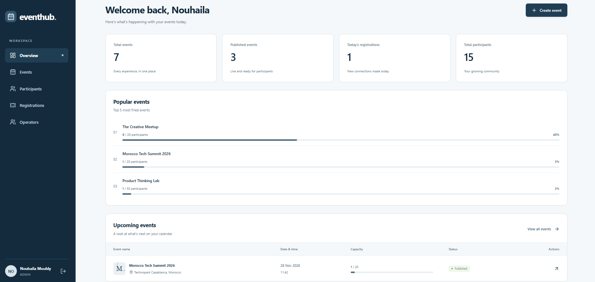
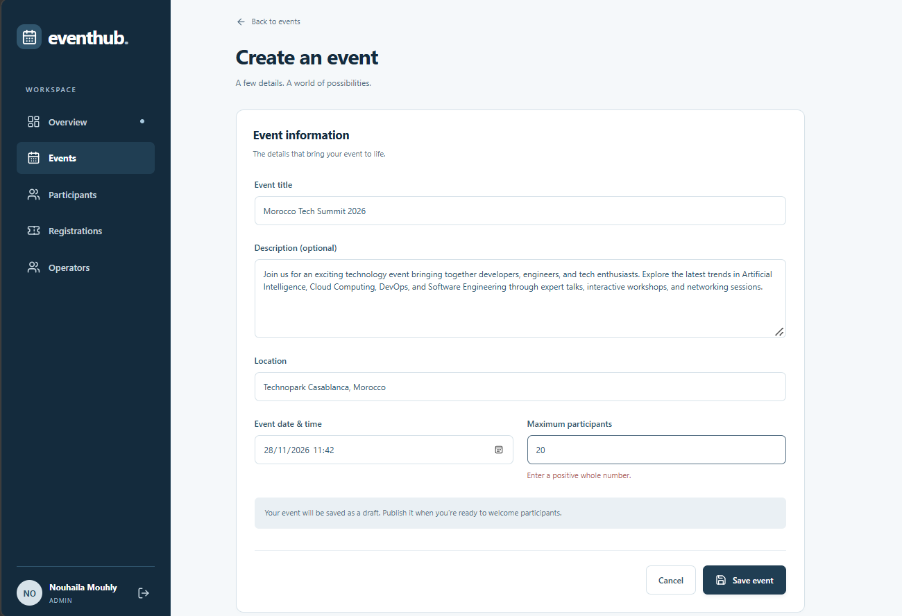
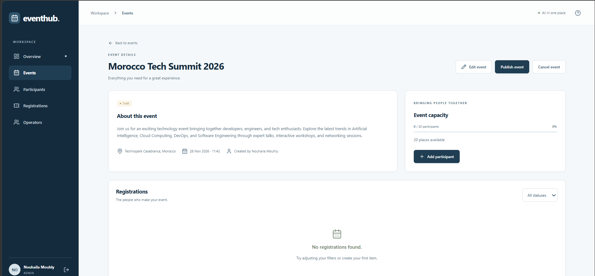
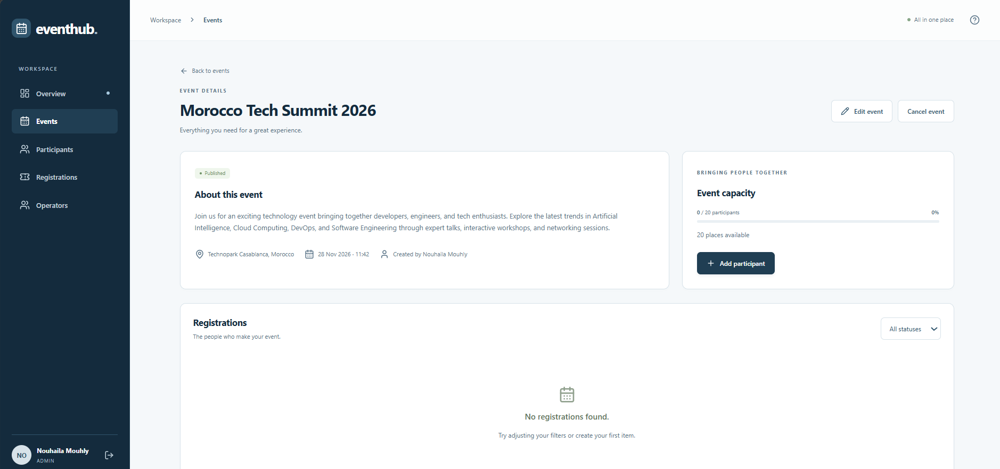
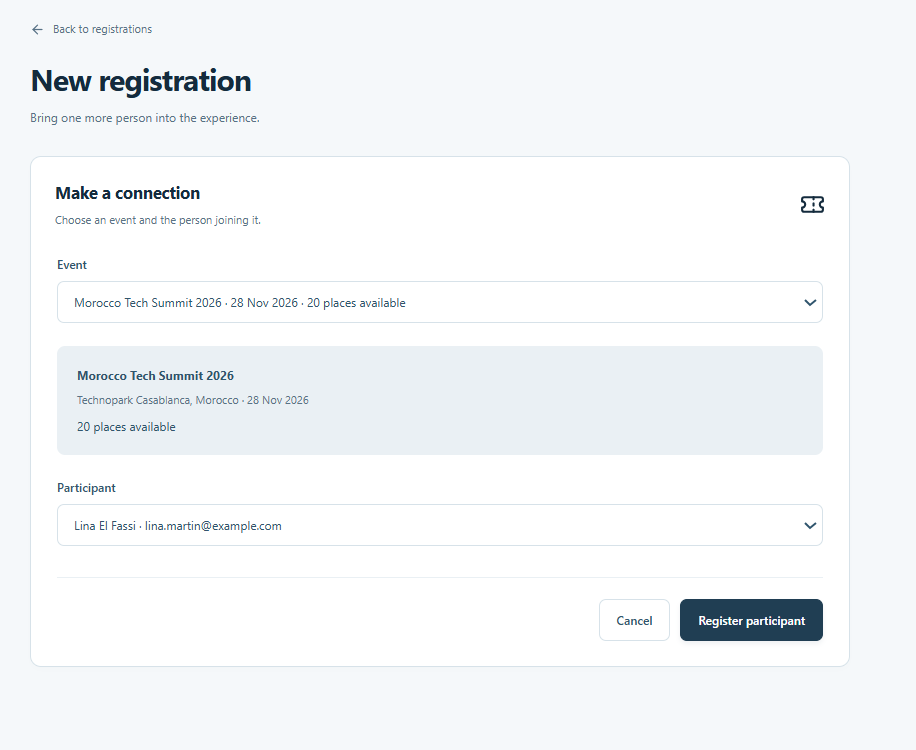
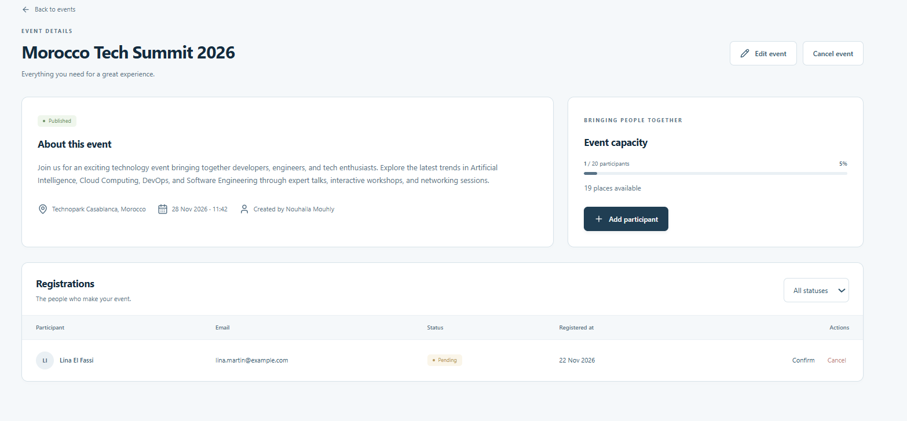
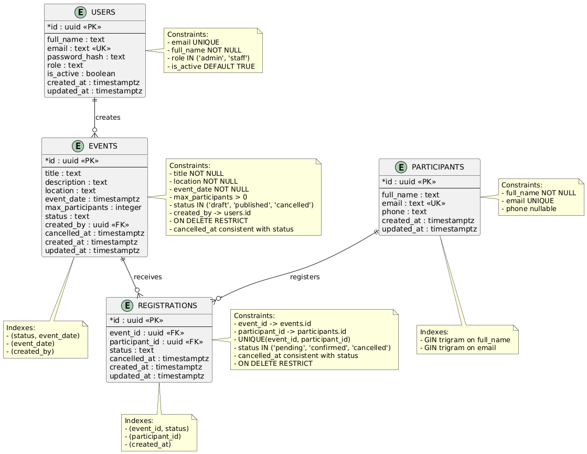

# EventHub — Gestion d'Événements & Inscriptions

Application web full-stack de gestion d'événements, participants et inscriptions, développée avec la stack PERN (PostgreSQL, Express, React, Node.js).

Elle permet à une équipe interne de créer et publier des événements, gérer les participants et suivre les inscriptions depuis un espace organisateur privé. Un portail public permet aux visiteurs de s'inscrire à un événement sans créer de compte.

---

## Démonstration

### Connexion à l’espace organisateur


### Tableau de bord organisateur (Overview)



### Création d’un événement



### Événement en brouillon



### Événement publié



Après publication, les visiteurs peuvent s'inscrire eux-mêmes et les organisateurs peuvent aussi ajouter un participant depuis leur espace.

### Formulaire d'inscription public


### Inscription depuis l’espace organisateur



### Fiche événement — capacité et suivi des inscriptions



---

## Fonctionnalités principales

**Espace organisateur (JWT requis)**
- Dashboard avec statistiques en temps réel (événements, inscriptions du jour, top 5)
- Gestion complète des événements (création, édition, publication, annulation)
- Gestion des participants (CRUD, recherche par nom ou email)
- Gestion des inscriptions (filtres, confirmation, annulation, réactivation)
- Gestion des comptes opérateurs (admin uniquement)

**Portail public (sans compte)**
- Catalogue des événements publiés à venir
- Inscription en ligne avec coordonnées (sans création de compte)

**Sécurité et robustesse**
- Authentification JWT avec expiration, issuer et audience
- Rôles admin / staff appliqués au niveau HTTP et base de données
- Transactions PostgreSQL avec verrous `FOR UPDATE` contre les race conditions
- Validation stricte des entrées côté backend (Zod) et frontend
- Rate limiting sur le login et les inscriptions publiques

---

## Stack technique

| Couche | Technologie |
|---|---|
| Frontend | React 19, Vite 6, React Router 7, Axios, Tailwind CSS 4 |
| Backend | Node.js 22, Express 5, JWT (jsonwebtoken), bcrypt |
| Base de données | PostgreSQL 17, driver `pg` |
| Validation | Zod (backend), validation custom (frontend) |
| Tests backend | Jest 30, Supertest |
| Tests frontend | Playwright, Node.js test runner |
| Documentation API | Swagger UI / OpenAPI 3.0 |
| Déploiement | Docker Compose (3 services) |

---

## Architecture

```
eventhub-frontend/    React + Vite — pages, composants, couche API Axios
eventhub-backend/     Express — routes / controllers / services / repositories
  database/           schema.sql, seed.sql
  docs/               verification.md (résultats de tests)
docs/                 ERD, architecture globale
scripts/              Configuration et vérification Docker
compose.yaml          Orchestration des 3 services (frontend, backend, postgres)
```

L'architecture backend suit une séparation stricte en 4 couches :
**Routes** (validation) → **Controllers** (HTTP) → **Services** (métier) → **Repositories** (SQL).

Voir [docs/architecture.md](docs/architecture.md) pour le schéma détaillé.
Voir [docs/erd.md](docs/erd.md) pour le modèle de données, les contraintes et les index.

---

## Prérequis

- [Node.js](https://nodejs.org/) 22.12 ou supérieur
- [PostgreSQL](https://www.postgresql.org/) 13+ avec extensions `pg_trgm` et `pgcrypto`
- [Docker Desktop](https://www.docker.com/products/docker-desktop/) (optionnel, recommandé)
- npm (inclus avec Node.js)

---

## Installation et lancement

### Option A — Docker (recommandé, tout-en-un)

```bash
git clone https://github.com/Nmouhly/EventHub.git
cd EventHub

# Génère les secrets dans .env (ne remplace pas un fichier existant)
node scripts/setup-docker-env.mjs

# Démarre les 3 services avec healthchecks
docker compose up --build -d --wait

# Charge les données de démonstration (une seule fois, sur base vide)
docker compose exec backend npm run db:seed
```

| Service | URL |
|---|---|
| Application | http://localhost:18080 |
| Swagger / API docs | http://localhost:18080/api/docs/ |
| API health | http://localhost:5002/api/health |

Pour arrêter : `docker compose down` (les données PostgreSQL sont conservées dans un volume).

Voir [DOCKER.md](DOCKER.md) pour la configuration avancée, les ports et le débogage.

---

### Option B — Installation locale (sans Docker)

**1. PostgreSQL**

Créer deux bases de données :

```sql
CREATE DATABASE eventhub;
CREATE DATABASE eventhub_test;
```

**2. Backend**

```bash
cd eventhub-backend
npm install
cp .env.example .env
# Éditer .env avec les identifiants PostgreSQL et un JWT_SECRET aléatoire
# Générer un secret : node -e "console.log(require('crypto').randomBytes(48).toString('hex'))"

npm run db:create    # crée la base si elle n'existe pas
npm run db:schema    # applique schema.sql
npm run db:seed      # charge les données de démonstration
npm run dev          # démarre en mode développement (hot-reload)
```

**3. Frontend**

```bash
cd eventhub-frontend
npm install
cp .env.example .env
# .env contient VITE_API_URL=http://localhost:5000/api
npm run dev
```

Ouvrir **http://localhost:5173**.

---

## Variables d'environnement

### Racine `.env` (Docker uniquement)

| Variable | Description |
|---|---|
| `POSTGRES_PASSWORD` | Mot de passe PostgreSQL (hexadécimal recommandé) |
| `JWT_SECRET` | Secret JWT (≥ 32 caractères) |
| `FRONTEND_PORT` | Port frontend Docker (défaut : 18080) |
| `BACKEND_PORT` | Port backend Docker (défaut : 5002) |
| `POSTGRES_PORT` | Port PostgreSQL exposé (défaut : 55433) |

### `eventhub-backend/.env`

| Variable | Description |
|---|---|
| `NODE_ENV` | `development` / `production` / `test` |
| `PORT` | Port du serveur Express (défaut : 5000) |
| `DATABASE_URL` | URL de connexion PostgreSQL principale |
| `TEST_DATABASE_URL` | URL de connexion PostgreSQL pour les tests |
| `JWT_SECRET` | Secret JWT (≥ 32 caractères, refusé si placeholder) |
| `JWT_EXPIRES_IN` | Durée de validité du token (défaut : `8h`) |
| `FRONTEND_URL` | Origine autorisée par CORS |
| `APP_TIMEZONE` | Timezone pour les bornes de jour du dashboard |

### `eventhub-frontend/.env`

| Variable | Description |
|---|---|
| `VITE_API_URL` | URL de base de l'API |
| `VITE_USE_MOCKS` | `true` pour le mode démo offline (défaut : `false`) |

---

## Comptes de démonstration

| Rôle | Email | Mot de passe |
|---|---|---|
| Admin | admin@eventhub.demo | EventHub2026! |
| Staff | staff@eventhub.demo | EventHub2026! |

Le seed charge : 5 événements (draft / published / cancelled), 10 participants, 20 inscriptions (pending / confirmed / cancelled).

---

## Parcours de démonstration recommandé

1. **Login** → http://localhost:18080/login avec le compte admin
2. **Dashboard** → statistiques, top 5 événements, prochains événements
3. **Events → Create event** → remplir titre, lieu, date, capacité → Save (créé en `draft`)
4. **Publish event** → confirmer dans le dialog → statut `published`
5. **Participants → Add participant** → créer une fiche
6. **Registrations → New registration** → sélectionner l'événement et le participant
7. **Event details** → voir la liste des inscriptions, confirmer (pending → confirmed)
8. **Dashboard** → vérifier que les statistiques se mettent à jour

**Portail public** (sans compte) : http://localhost:18080 → parcourir les événements → s'inscrire

---

## Tests

### Backend

```bash
cd eventhub-backend

npm test              # tous les tests (Jest + Supertest)
npm run test:unit     # tests unitaires (validators, services mockés)
npm run test:integration  # tests d'intégration sur base PostgreSQL dédiée
```

Prérequis : `TEST_DATABASE_URL` définie dans `eventhub-backend/.env`, base se terminant par `_test`.

### Frontend

```bash
cd eventhub-frontend

npm test              # tests unitaires (validation)
npm run test:e2e      # Playwright offline (mode mocks, port 5174)
npm run test:e2e:live # Playwright avec API réelle (nécessite backend + DB de test)
npm run build         # vérifie que le build de production passe
```

Résultats de la dernière validation complète : [eventhub-backend/docs/verification.md](eventhub-backend/docs/verification.md).

---

## API et Swagger

La documentation interactive Swagger est disponible à `/api/docs/` une fois le projet démarré.

**Explorer l'API :**
1. Ouvrir http://localhost:18080/api/docs/
2. `POST /auth/login` → Try it out → copier le `token`
3. Cliquer **Authorize** → coller le token (sans `Bearer`) → Authorize
4. Tester les endpoints protégés

La spécification OpenAPI est disponible à `/api/openapi.json` (importable dans Postman).

Voir [SWAGGER.md](SWAGGER.md) pour le guide complet.

---

## Règles métier importantes

- Un événement est créé en `draft`. Il doit être publié pour accepter des inscriptions.
- Transitions d'état : `draft → published → cancelled`. L'état `cancelled` est terminal.
- L'annulation d'un événement annule automatiquement toutes ses inscriptions actives (atomique).
- Un participant ne peut pas s'inscrire deux fois au même événement. Une inscription annulée peut être réactivée sur la même ligne.
- La capacité (`maxParticipants`) ne peut pas être réduite en dessous du nombre d'inscrits actifs.
- Les inscriptions `pending` et `confirmed` comptent toutes les deux dans la capacité.
- La suppression d'un participant est refusée s'il a au moins une inscription (même annulée).
- Au moins un administrateur actif doit toujours exister.

---

## Sécurité

- **JWT** : HS256, expiration 8h, issuer et audience vérifiés, `is_active` relu en DB à chaque requête
- **Mots de passe** : bcrypt coût 12, jamais exposés dans les réponses API
- **Validation** : Zod strict côté backend (`.strict()` rejette les champs inconnus), validation native côté frontend
- **Injection SQL** : toutes les requêtes utilisent des paramètres liés (`$1, $2…`)
- **Rate limiting** : 50 tentatives de login / 15 min / IP ; 30 inscriptions publiques / 15 min / IP
- **CORS** : origine unique autorisée (configurée via `FRONTEND_URL`)
- **Headers** : Helmet actif sur toutes les réponses
- **Concurrence** : verrous `FOR UPDATE` PostgreSQL pour garantir l'intégrité de la capacité

---

## Choix techniques

**PostgreSQL plutôt qu'un ORM** : les requêtes SQL sont écrites à la main dans les repositories, ce qui donne un contrôle total sur les verrous, les transactions et les performances. Pas de magie cachée.

**Express 5** : gestion native des erreurs async (plus besoin de `try/catch` dans chaque handler). Les erreurs async sont automatiquement propagées à `errorHandler`.

**Zod pour la validation** : schémas définis une seule fois, réutilisés dans les middlewares. `.strict()` bloque le mass assignment dès la validation.

**`sessionStorage` pour le JWT** : non-persistent, isolé par onglet, disparaît à la fermeture. Choix adapté à un outil interne.

**Mode démo offline** : `VITE_USE_MOCKS=true` active un serveur mock complet qui n'est pas inclus dans le bundle de production. Permet de tester le frontend sans backend.

**Architecture 4 couches** : séparation stricte Routes / Controllers / Services / Repositories. La logique métier réside uniquement dans les services — testable sans Express ni PostgreSQL.

---

## Limites actuelles

- Pas de refresh token : la session expire au bout de 8h et l'utilisateur doit se reconnecter.
- Pas de vérification d'email : les inscriptions publiques sont déclaratives. Une vérification par email serait nécessaire avant un déploiement public à grande échelle.
- Les sélecteurs de formulaire chargent toutes les pages disponibles (jusqu'à 100 items par requête) — une recherche serveur serait plus adaptée pour de grands volumes.
- Pas de liste de révocation JWT : la désactivation d'un compte bloque les nouvelles requêtes (is_active vérifié en DB), mais un token déjà émis reste valide jusqu'à son expiration naturelle.
- Cette configuration Docker est destinée au développement et à la démonstration. Un déploiement public nécessiterait HTTPS, sauvegardes et configuration de proxy de confiance.

---

## Améliorations futures

- Envoi d'emails de confirmation aux participants lors de l'inscription
- Vérification d'email pour le portail public
- Refresh token avec révocation explicite
- Export des listes de participants par événement (CSV/PDF)
- Notifications en temps réel (WebSocket) pour les changements de statut
- Recherche serveur sur les sélecteurs de formulaire (autocomplétion)
- Internationalisation (i18n) du portail public
- Déploiement cloud avec CI/CD

---

## Database Design



Le modèle de données repose sur 4 tables : `users`, `events`, `participants`, `registrations`.
Relations, contraintes (PK/FK/UNIQUE/CHECK) et index sont détaillés dans [docs/erd.md](docs/erd.md).
Source PlantUML : [docs/erd.puml](docs/erd.puml).

---

## Documentation

| Document | Contenu |
|---|---|
| [docs/architecture.md](docs/architecture.md) | Schéma d'architecture, couches, flux auth |
| [docs/erd.md](docs/erd.md) | ERD détaillé — tables, contraintes, index |
| [docs/erd.svg](docs/erd.svg) | ERD visuel (PlantUML) |
| [eventhub-backend/README.md](eventhub-backend/README.md) | API complète, règles métier, contrat HTTP |
| [eventhub-frontend/README.md](eventhub-frontend/README.md) | Frontend, routes, mode démo |
| [DOCKER.md](DOCKER.md) | Docker Compose, ports, variables, débogage |
| [SWAGGER.md](SWAGGER.md) | Guide d'exploration de l'API avec Swagger UI |
| [eventhub-backend/docs/verification.md](eventhub-backend/docs/verification.md) | Résultats de la recette finale |
