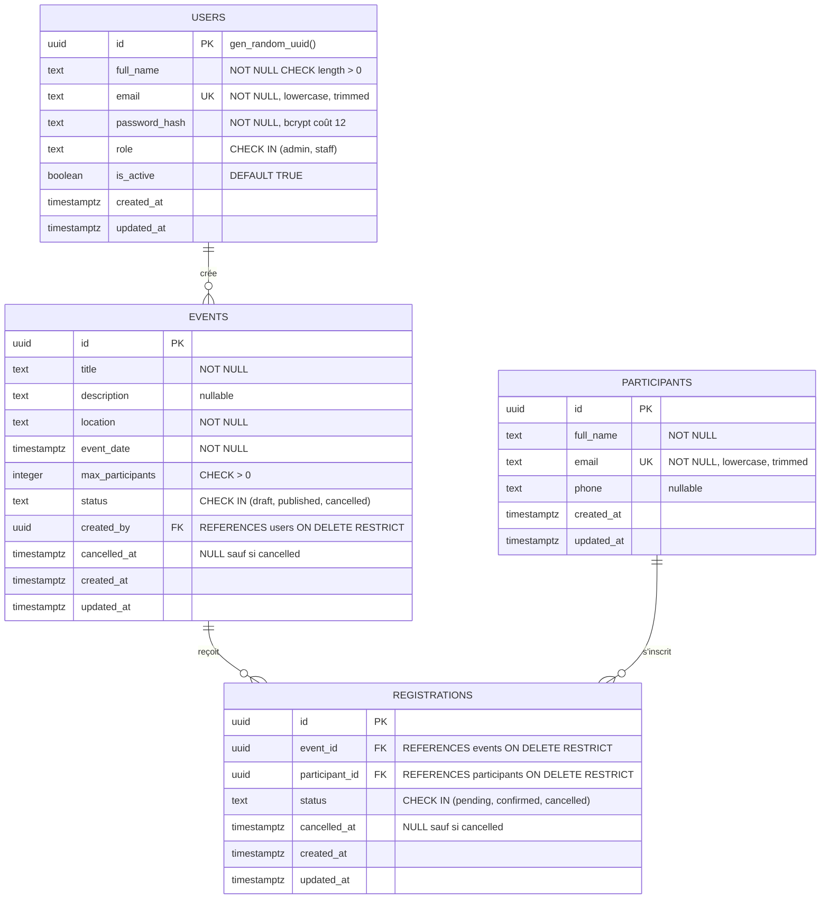

# Schéma de base de données — EventHub

## ERD

## Tables

### `users`
Opérateurs internes de l'application. Deux rôles : `admin` (gestion complète + opérateurs) et `staff` (événements, participants, inscriptions). Les comptes sont désactivés (`is_active = false`) plutôt que supprimés pour préserver l'historique des événements créés.

### `events`
Événements créés par les opérateurs. Cycle de vie : `draft → published → cancelled`. Le statut `cancelled` est terminal. Le champ `cancelled_at` est synchronisé avec le statut par une contrainte CHECK.

### `participants`
Personnes qui s'inscrivent à des événements. Peuvent être ajoutées par le staff ou créées automatiquement via le portail public (par email). Un email identifie de façon unique un participant — une fiche existante n'est jamais modifiée lors d'une inscription publique.

### `registrations`
Table de jonction N-N entre `events` et `participants`. La contrainte UNIQUE `(event_id, participant_id)` est permanente — une inscription annulée peut être réactivée sur la même ligne. Le statut `cancelled` est synchronisé avec `cancelled_at`.

## Contraintes importantes

| Table | Contrainte | Type | Description |
|---|---|---|---|
| `users` | `users_email_key` | UNIQUE | Un email par opérateur |
| `users` | CHECK | CHECK | `role IN ('admin', 'staff')` |
| `events` | CHECK | CHECK | `status IN ('draft', 'published', 'cancelled')` |
| `events` | `events_cancellation_check` | CHECK | `(status = 'cancelled') = (cancelled_at IS NOT NULL)` |
| `events` | `events_created_by_fkey` | FK | `ON DELETE RESTRICT` |
| `participants` | `participants_email_key` | UNIQUE | Un email par participant |
| `registrations` | `registrations_event_participant_key` | UNIQUE | Un seul enregistrement par (event, participant) |
| `registrations` | `registrations_cancellation_check` | CHECK | `(status = 'cancelled') = (cancelled_at IS NOT NULL)` |
| `registrations` | `registrations_event_id_fkey` | FK | `ON DELETE RESTRICT` |
| `registrations` | `registrations_participant_id_fkey` | FK | `ON DELETE RESTRICT` |

## Index

| Index | Table | Colonnes | Type | Utilisation |
|---|---|---|---|---|
| `events_status_date_idx` | events | `(status, event_date)` | B-tree | Filtres liste + dashboard |
| `events_date_idx` | events | `(event_date)` | B-tree | Filtre par date |
| `events_creator_idx` | events | `(created_by)` | B-tree | FK events→users |
| `participants_name_trgm_idx` | participants | `full_name` | GIN trigramme | Recherche ILIKE |
| `participants_email_trgm_idx` | participants | `email` | GIN trigramme | Recherche ILIKE |
| `registrations_event_status_idx` | registrations | `(event_id, status)` | B-tree | Comptage places actives |
| `registrations_participant_idx` | registrations | `(participant_id)` | B-tree | FK registrations→participants |
| `registrations_created_idx` | registrations | `(created_at)` | B-tree | Dashboard inscriptions du jour |

## Scripts SQL

| Fichier | Rôle |
|---|---|
| `eventhub-backend/database/schema.sql` | Création des tables, contraintes, index et triggers |
| `eventhub-backend/database/seed.sql` | Données de démonstration (exécuté via `npm run db:seed`) |

Le seed inclut : 1 admin, 1 staff, 5 événements (draft / published / cancelled), 10 participants, 20 inscriptions (pending / confirmed / cancelled).

> **Note :** Ne pas exécuter `seed.sql` directement — le script Node.js génère le hash bcrypt et le transmet à la session PostgreSQL via `set_config`. Aucun mot de passe en clair n'est stocké.
